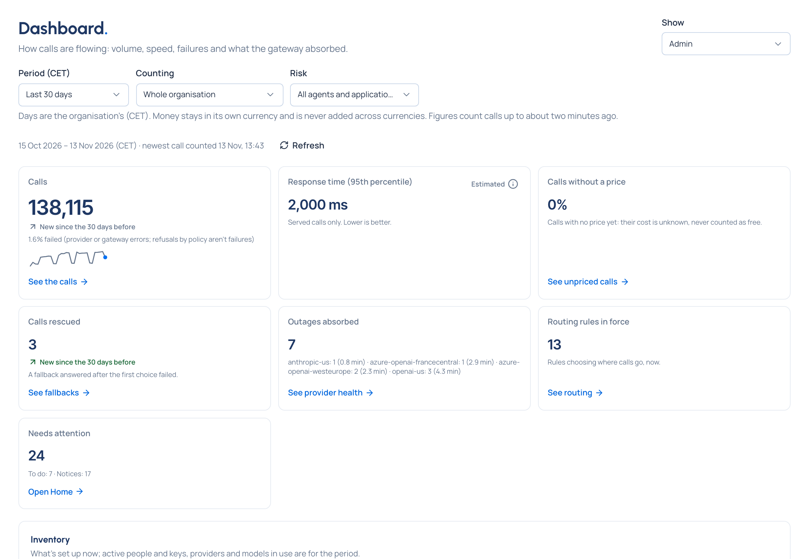
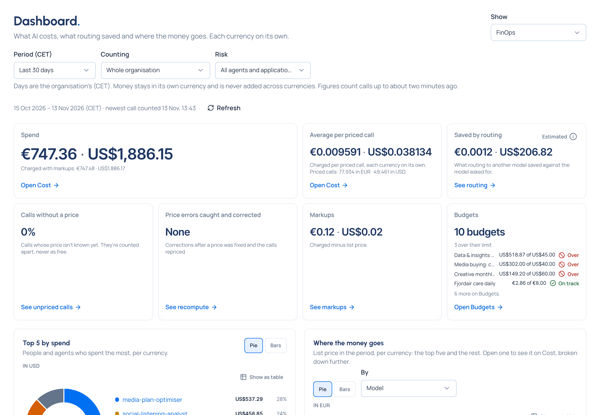
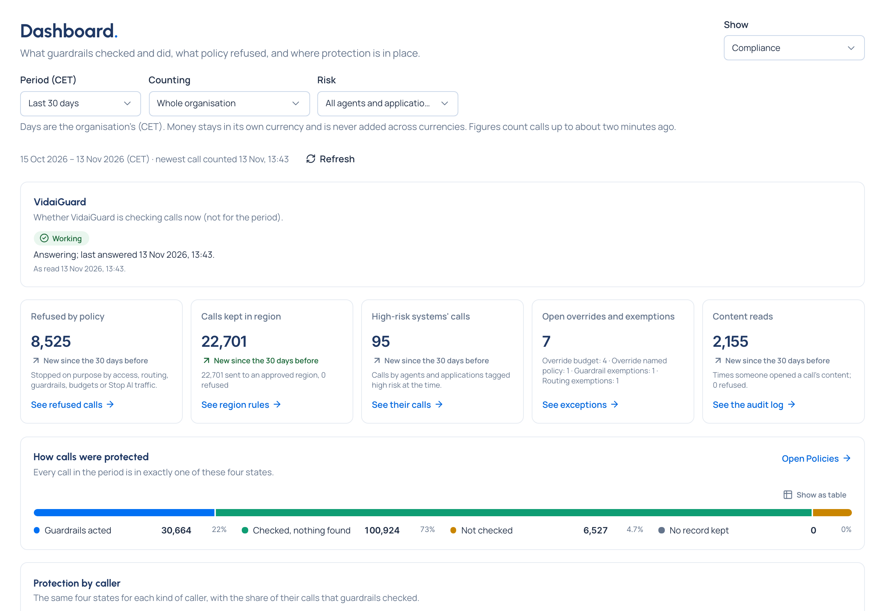

# Vidai — The Governance-First AI Control Room

[](https://github.com/vidaiUK/vidai-quickstart/releases/latest)
[](https://vidai.uk/cosign)
[](https://vidai.uk/about)

**Every AI call your organisation makes, governed as it happens: cost, regulation and data, inside your own network.**

One configuration change, and every AI call is governed. Your applications keep
their OpenAI, Anthropic, Bedrock or Gemini code and send their calls through
Vidai, which applies your rules to each call, prices it and records the proof.
The **Control room** is where your people see and run it all.

> [!NOTE]
> **Vidai 1.0 is a new installation.** It doesn't upgrade 0.8 in place.
> Moving from 0.8? [Contact us](https://vidai.uk/contact) and we'll help.

[**Download Community**](https://github.com/vidaiUK/vidai-quickstart/releases/latest)
&nbsp;·&nbsp; [Documentation](https://docs.vidai.uk)
&nbsp;·&nbsp; [Talk to us](https://vidai.uk/contact)

---

## See It

### Admin Dashboard
How calls are flowing: how many, how fast, what failed, and the provider outages Vidai absorbed for you.



### FinOps Dashboard
What AI costs, what routing saved, and how each budget is doing, per team and in each currency.



### Compliance Dashboard (Enterprise)
What the guardrails checked and did, what policy refused, and which calls stayed in an approved region.



---

## What's in 1.0

- **Cost as it happens.** Every call is priced within minutes and belongs to a team, an application and a person. Budgets can warn, stop calls, or send them to another model.
- **Rules in the traffic.** Guardrails find personal data, card numbers, secrets and prompt injection, and block or mask them as the call passes. Watch a policy first, then switch it on.
- **Proof for auditors.** A tamper-evident audit log, and on Enterprise a signed report for any period.
- **Everyone sees their own work.** Admins, Finance, compliance officers and users each get the view they need. Users issue their own keys and see why a call was refused.
- **One switch to stop it all.** Stop all AI traffic from any page, on every gateway, until an admin turns it back on.

---

## Editions

| | Community | Enterprise |
|---|---|---|
| **Install** | Docker, one host (this repository) | Docker, and Helm for Kubernetes, from your account manager |
| **Adds** | | Single sign-on, Compliance dashboard and regulations, VidaiGuard, auditor reports, BI and SIEM exports |

Licences come from [portal.vidai.uk](https://portal.vidai.uk) (Community) or your account
manager (Enterprise). Moving from Community to Enterprise is a licence change; nothing is reinstalled.

---

## Install Community

You need Linux or macOS with Docker Engine 24+ and Docker Compose 2.20+. Run these in one terminal:

```sh
# The newest release (or set VERSION yourself, as listed on Releases, without the "v")
VERSION=$(curl -fsSL https://api.github.com/repos/vidaiUK/vidai-quickstart/releases/latest \
  | grep -m1 '"tag_name"' | cut -d'"' -f4 | sed 's/^v//')

curl -LO https://github.com/vidaiUK/vidai-quickstart/releases/download/v${VERSION}/vidai-community-${VERSION}.tar.gz
tar xzf vidai-community-${VERSION}.tar.gz
cd vidai-community-${VERSION}
cp /path/to/your/vidai.license .   # optional; you can try Vidai without one

./setup.sh             # asks for your address, the ports to use and the first admin
docker compose up -d
```

Open the Control room at the address you gave `setup.sh` and sign in. The full guide is
[Install Vidai](https://docs.vidai.uk/get-started/install/).

---

## Verify What You Run

Every release is signed by Vidai UK Limited. The key is at [vidai.uk/cosign](https://vidai.uk/cosign).

```sh
curl -o cosign.pub https://vidai.uk/.well-known/cosign.pub
curl -LO https://github.com/vidaiUK/vidai-quickstart/releases/download/v${VERSION}/vidai-community-${VERSION}.tar.gz.bundle
cosign verify-blob --key cosign.pub --bundle vidai-community-${VERSION}.tar.gz.bundle vidai-community-${VERSION}.tar.gz
```

Optional: Vidai runs the same either way.

---

## Support

| | |
|---|---|
| Documentation | https://docs.vidai.uk |
| Problems with a release | [Open an issue](https://github.com/vidaiUK/vidai-quickstart/issues) |
| Enterprise, licences, moving from 0.8 | https://vidai.uk/contact |
| Security | security@vidai.uk |
| Everything else | support@vidai.uk |

Vidai is made by **Vidai UK Limited**, Scotland. Companies House SC863190.
